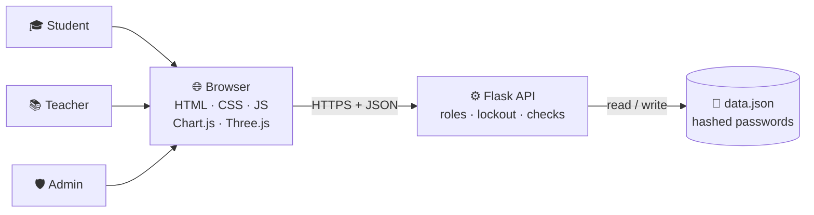

<div align="center">


<a href="https://mohit20678.pythonanywhere.com"></a>

<br>

<a href="https://mohit20678.pythonanywhere.com"></a>

<br><br>


<br>


<br><br>

**One secure portal for students, teachers and the admin, with live charts, a 3D pie chart, a smart 75% calculator and merit lists.**

</div>

---

## 📌 The Problem

In most colleges, student information, attendance and marks are kept in paper registers and scattered spreadsheets. This makes it slow to find students with low attendance, to see one student's complete record, or to rank a class. Students also do not know how many classes they must attend to reach the 75% limit, or how many they can safely skip, until it is too late.

**AttendX** solves this with one secure web portal where every person sees exactly what belongs to them.

<table>
<tr>
<td width="33%" valign="top">

### 🎓 Student
Sees only their own data: attendance charts, a rotating 3D pie, marks, and how many classes to attend (or skip).

</td>
<td width="33%" valign="top">

### 📚 Teacher
Marks attendance for their subjects, sees names in red, yellow and green, and enters marks with analysis and merit lists.

</td>
<td width="33%" valign="top">

### 🛡️ Admin
Manages students, teachers and subjects, sees graphs for everyone, and handles password resets.

</td>
</tr>
</table>

---

## 📸 Screenshots

<!-- DRAG YOUR SCREENSHOTS HERE -->

---

## 🧭 How It Works



## 🚦 Attendance, Colour-Coded

| Colour | Meaning | What the teacher sees |
|---|---|---|
| 🟢 Green | Above 80% | Safe |
| 🟡 Yellow | 75% to 80% | Borderline, keep an eye on them |
| 🔴 Red | Below 75% | Needs to attend more classes |

```
Attendance %                  = present / total x 100
Classes needed to reach 75%   = 3 x total - 4 x present
Classes you can skip at 75%   = floor((4 x present - 3 x total) / 3)
```

---

## ✨ Features

<details open>
<summary><b>🎓 Student</b></summary>

- Subject-wise bar chart with the 75% limit line
- **3D pie chart** (drag to rotate): present vs absent, overall or per subject
- Attendance percentage with red, yellow and green status
- **Attendance calculator:** classes needed to reach the target, classes that can be skipped, and a "what if I attend or miss the next N classes" mode
- Marks table: Mid 1, Mid 2, Internal, Class Test, Semester

</details>

<details open>
<summary><b>📚 Teacher</b></summary>

- Mark attendance by date for their own subjects (saving a date again updates it)
- Names coloured **red**, **yellow** and **green** by attendance
- Enter all five mark types, checked against the maximum marks
- **Marks analysis:** highest, lowest and average marks with names, a ranked **merit list**, and students with the **same marks**

</details>

<details open>
<summary><b>🛡️ Admin</b></summary>

- Add and delete students (one by one or paste a whole class), teachers and subjects
- Graphs for all students, classes and subjects, and a per-student view with marks
- Class-wide merit list across all subjects
- Password reset requests and a one-time admin recovery code
- Password-protected Excel export of the whole database

</details>

---

## 🔐 Security

| Protection | How |
|---|---|
| Passwords | Stored only as salted hashes, never as plain text |
| Roles | Every API checks the logged-in role. A student sees only their own data, a teacher only their own subjects |
| Login lockout | An account locks for 5 minutes after 5 wrong passwords |
| First login | New or reset accounts must choose their own password (minimum 8 characters) |
| Forgot password | Students and teachers send a request and the admin gives a one-time temporary password. The admin uses a saved one-time recovery code |
| Input checks | Roll numbers, subject codes and classes accept only safe characters |
| Sessions | HttpOnly and SameSite cookies, 8-hour login, no caching of API data, anti-framing headers |
| Privacy | `data.json` and the secret key are in `.gitignore` and never uploaded |

## 🛠️ Tech Stack

| Layer | Technology |
|---|---|
| Frontend | HTML, CSS, JavaScript, Chart.js, Three.js (3D) |
| Backend | Python, Flask, REST API |
| Database | JSON file (`data.json`), created automatically |
| Hosting | PythonAnywhere (free plan) |

## 🗂️ Project Structure

```
student-dashboard/
├── app.py               # Flask backend: roles, security, REST API
├── test_api.py          # 55 automatic tests (use a temporary database)
├── fill_sample.py       # fills sample attendance and marks for demos
├── seed_test.py         # small test-data helper
├── check_project.py     # checks that all files and features are in place
├── export_secure.py     # admin-only, password-protected Excel export
├── requirements.txt
└── static/
    ├── login.html  student.html  teacher.html  admin.html
    ├── common.js        # shared helpers, 3D background, analysis display
    └── style.css  theme3d.css
```

---

## 🚀 Run It Locally

```
python -m venv venv
source venv/Scripts/activate      # Windows Git Bash
pip install -r requirements.txt
python app.py
```

Open http://127.0.0.1:5000

On the first run the terminal prints a line starting with `FIRST RUN` that shows the admin username (`admin`) and a random temporary password. Log in on the **Admin** tab and choose your own password straight away. Then add teachers, students (`rollno, name, class`) and subjects.

Optional sample data for demos (after adding students, teachers and subjects):

```
python fill_sample.py fill
python fill_sample.py clear
```

## ✅ Tests

```
python test_api.py
```

55 checks cover login, role permissions, the 75% maths, marks limits, password rules, lockout, forgot-password flows and data cleanup. They run on a temporary database, so real data is never touched.

## ☁️ Deployment

Hosted free on PythonAnywhere: clone the repo, create a virtualenv with Flask, upload `data.json`, create a *Manual configuration* web app, point the WSGI file to `from app import app as application`, set `HTTPS_ONLY=1`, and reload. The free plan needs the "Run until 1 month from today" button pressed once a month.

## 🎮 Try It

| Role | Username | Password |
|---|---|---|
| Student (demo) | `22CS004` | `22CS004` |

The live site uses **sample data only**. Teacher and admin logins are shared on request.

## 🔮 Future Scope

- Installable mobile app on the same API
- SQL database (MySQL or PostgreSQL) for a whole college
- Excel and PDF reports, and low-attendance alerts by SMS or email

---

## 👥 Team

| Member | Role |
|---|---|
| **Mohit** | Backend, security and hosting |
| **Raheem** | Problem statement and presentation |
| **Ruchik** | Student dashboard |
| **Moin** | Teacher and admin panels |

**Faculty guide:** Dr. Siddapuram Arvind / Ms Sravya

<div align="center">

<sub>Built as a PBL project. The demo uses sample data only, and real student data never goes to GitHub.</sub>

</div>
